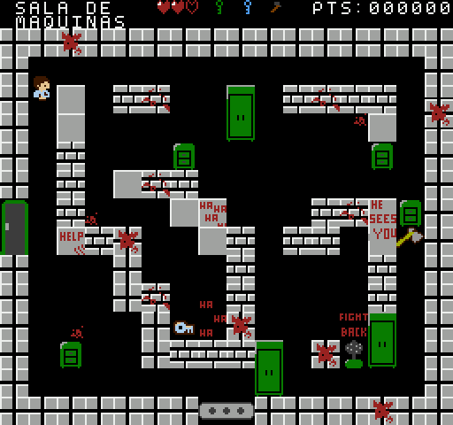
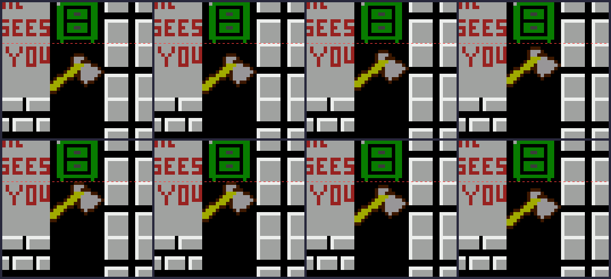

# Machado só na Sala de Máquinas, flutuando

O machado agora:

- **aparece só na Sala de Máquinas**, no canto circulado: o corredor da direita, **logo abaixo da lixeira** e à direita da placa "WE SEES YOU". Em pixels, o ponto é **(224, 128)**.
- **fica subindo e descendo** como as chaves: sobe e desce de 1 em 1 pixel, em degraus, num total de 3 pixels. Um ciclo dura 64 quadros (um pouco mais de 1 segundo).
- **só pode ser pego nessa sala.** Nas outras salas ele fica escondido.

Antes, o machado aparecia em todas as salas, no canto de cima à esquerda (32, 32).



## O que alterar no jogo (1 arquivo)

**Só o `src/machado.s` muda.** Não mexe em `main.s`, `constantes.inc`, `TitleSprites.chr` nem em nenhum outro arquivo.

Duas formas:

1. **Substituir o arquivo.** Copie o `machado.s` desta pasta por cima do `src/machado.s` do AOC. Este arquivo é o `machado.s` atual do AOC (commit `0c60c7e`) com as mudanças abaixo.
2. **Aplicar o patch**, com o git instalado, na pasta do AOC: `git apply machado_maquinas.patch`. Para desfazer: `git apply -R machado_maquinas.patch`.

### As 5 mudanças (para você conferir)

**1. Sala e posição do machado**, no bloco `CONFIGURACAO`. Estas são as únicas linhas que você muda se quiser outro lugar ou outra sala:

```asm
AX_SALA      = ROOM_MAQUINAS ; sala onde o machado fica no chao: so la ele aparece e so la da pra pegar
AX_ITEM_X    = 224          ; corredor da direita da Sala de Maquinas, logo abaixo da lixeira
AX_ITEM_Y    = 128
```

**2. A constante da sala**, logo antes do `CONFIGURACAO`. Ela só vale se o jogo ainda não tiver a sua própria `ROOM_MAQUINAS`:

```asm
.ifndef ROOM_MAQUINAS
ROOM_MAQUINAS = 2
.endif
```

**3. Em `machado_update`**, só dá para pegar na sala dele (3 linhas depois do "já pegou?"):

```asm
    lda room
    cmp #AX_SALA
    bne @desenha
```

**4. Em `machado_draw`**, no machado do chão: só desenha na sala dele, e flutua:

```asm
    lda room
    cmp #AX_SALA
    beq @no_chao
    ldx #AX_OAM_CHAO
    jmp ax_hide             ; outra sala: esconde
@no_chao:
    ...
    lda anim_timer          ; flutua: sobe e desce 0 a 3 pixels
    lsr a
    lsr a
    lsr a                   ; o passo muda a cada 8 quadros
    and #%00000111
    tay
    lda #AX_ITEM_Y
    sec
    sbc ax_tab_sobe, y
    sta ax_y
```

**5. A tabela da subida**, no fim, junto de `ax_tab_set`:

```asm
ax_tab_sobe: .byte 0, 1, 2, 3, 3, 2, 1, 0
```

Para o machado flutuar **mais rápido**, tire um `lsr a` (o passo passa a durar 4 quadros). Para flutuar **mais alto**, aumente os números de `ax_tab_sobe`.

## Importante: a Sala de Máquinas precisa estar ligada ao jogo

Na `main` do AOC a Sala de Máquinas **ainda não está ligada** (só existem `ROOM_SPAWN` e `ROOM_QUARTO2`). Enquanto isso, **o machado não aparece em lugar nenhum**, e portanto não dá para pegá-lo. Quando vocês ligarem a sala:

- ela precisa ser a **sala número 2** (a terceira nas tabelas `room_*` de `salas.s`), ou então defina `ROOM_MAQUINAS` no `constantes.inc` com o número certo. O `machado.s` e o `chaves.s` usam essa mesma constante.
- se vocês ligarem a sala antes de aplicar este patch, o machado já aparece nela.

Eu **não testei com a ligação real de vocês**, porque ela ainda não existe na `main`.

## Como o machado chega lá

O corredor da direita da Sala de Máquinas é fechado por cima pela lixeira, então se chega **por baixo**. Pelo cálculo com a hitbox real do jogo, da porta da esquerda até o machado são **534 passos** (uns 9 segundos), dando a volta pela sala: sobe até o corredor de cima, desce pelo meio, vai para a direita pela parte de baixo e sobe o corredor da direita. O personagem consegue pegar o machado a partir de 80 posições diferentes (a menos de 12 pixels dele).

## Para ver

- **`jogo_AOC_com_machado_na_sala_de_maquinas.nes`**: o jogo atual do AOC com a mudança. Como a Sala de Máquinas não está ligada, o machado **não aparece** nele (é o esperado). Serve para conferir que o resto do jogo está igual.
- **`demo_sala_de_maquinas.nes`**: o mesmo jogo com uma **ligação provisória** da Sala de Máquinas, só para esta demonstração: uma porta no corredor da direita do Quarto 2 leva a ela, e uma porta à esquerda da sala volta. Aperte START, vá ao Quarto 2 pela porta de baixo do Spawn, ande até o corredor da direita e entre pela porta. Nessa demo, a Sala de Máquinas usa as cores do arquivo que está na `main` hoje (os móveis aparecem verdes); a versão de vocês é mais nova.



A imagem acima mostra os 8 passos do ciclo (a linha vermelha é o topo do quadrado de 16x16 do machado no chão).

## O que foi verificado

Tudo com o `ca65`/`ld65` reais (versão 2.19) e o `make` do AOC, rodando as ROMs num simulador de NES meu:

- **O machado só aparece na Sala de Máquinas:** no Spawn e no Quarto 2 ele não aparece. Na Sala de Máquinas aparece no ponto certo, com os tiles e a paleta certos.
- **A flutuação:** em 200 quadros, a posição bate com um modelo escrito à parte. O machado sobe e desce entre Y=125 e Y=128, em degraus de 1 pixel, com ciclo de 64 quadros.
- **Pegar:** andando pelo corredor da direita, o personagem pega o machado, que some do chão e aparece na mão. O HUD recebe o machado (`items` passa de `00000000` para `00000100` e o ícone `$38` aparece). O golpe com A continua funcionando.
- **O resto do jogo não muda:** comparei o AOC antigo e o novo em 6 partidas com botões aleatórios. O personagem, as paletas, o fundo, o HUD, a névoa e as chaves ficaram idênticos. As únicas diferenças acontecem de propósito: nas partidas em que o jogador anda até o canto (32, 32), o AOC antigo pega o machado ali e o novo não, porque agora ele não está mais lá.
- `machado.s` compila sem erro. O único aviso (`ax_draw16 is defined but never used`) já existia antes da mudança.
- **Não foi testado no Mesen.** Eu rodei só no meu simulador.
